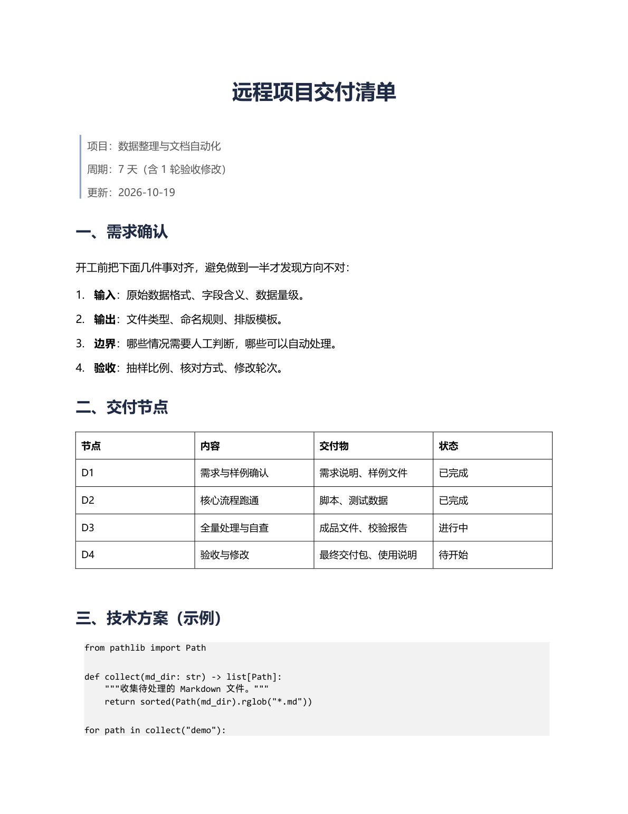

# 文档自动化工具链 · Doc Automation Toolkit

把 Markdown 转成排版好的中文 Word，再用真实的 LibreOffice 渲染成 PDF / PNG 做版式自查。

> Markdown → Word (.docx) → PDF/PNG preview. Built for Chinese business documents: headings, lists, tables, code blocks and quotes, with a render-based layout check before delivery.



## 功能

- **Markdown → Word**：支持标题、加粗、行内代码、代码块、引用、无序/有序列表、表格、水平线。
- **中文排版**：微软雅黑、1.35 倍行距、标题层级、表头跨页重复、代码块底纹。
- **单文件 CLI**：指定输入和输出路径，适合批处理脚本调用。
- **实际渲染自查**：用 LibreOffice 把 docx 转成 PDF，再转 PNG 逐页检查错位、溢出、缺字。
- **无 Office 依赖**：转换用 python-docx，渲染用 LibreOffice（可选）。

## 快速开始

```bash
pip install -r requirements.txt

# 1) Markdown -> Word
python md2docx.py demo/input.md demo/output.docx

# 2) Word -> PDF -> PNG（需要安装 LibreOffice）
python render_pdf.py demo/output.docx demo/render 140
```

生成的 `demo/render/slide-01.png` 就是下面这张预览图。

### LibreOffice 路径

`render_pdf.py` 按以下顺序查找：

1. 环境变量 `SOFFICE`
2. `PATH` 中的 `soffice`
3. Windows 默认安装路径 `C:\Program Files\LibreOffice\program\soffice.exe`

也可以设置 `SOFFICE_PROFILE` 指定临时配置目录。

## 两种用法

### 单文件

```bash
python md2docx.py path/to/input.md path/to/output.docx
```

### 批量

不带参数运行时，会扫描当前目录下所有 `.md`，输出到 `Word版/`：

```bash
python md2docx.py
```

## 适用场景

- 项目交付说明、需求文档、验收报告批量生成。
- 课程讲义、会议材料、知识库导出为 Word。
- 自动生成带统一版式的文档包，交付前做一次真实渲染检查。
- 把 AI / 脚本产出的 Markdown 快速转成可打印、可分发的 Word。

## 实现要点

1. 用 `python-docx` 创建文档并统一 Normal / Heading / List 样式。
2. 自己实现一层轻量 Markdown 解析：标题、列表、表格、代码块、引用、行内格式。
3. 表格表头设置 `w:tblHeader`，跨页时自动重复。
4. 引用段落用 `w:pBdr` 画左侧竖线；代码块用 `w:shd` 加底纹。
5. `render_pdf.py` 调 LibreOffice headless 转 PDF，再用 PyMuPDF 渲染 PNG。

## 依赖

- Python 3.10+
- `python-docx`
- `PyMuPDF`（仅渲染预览时需要）
- LibreOffice（仅渲染预览时需要）

## License

MIT License，见 [LICENSE](LICENSE)。
